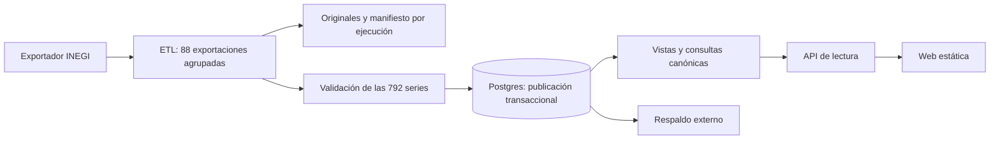

# Arquitectura y decisiones

## Decisiones de implementación

| Componente | Elección | Motivo |
|---|---|---|
| Repositorio | Monorepo | Un PR puede coordinar catálogo, API e interfaz |
| Python | 3.12 y uv existentes | Continuidad con el entorno ya preparado |
| Extracción | httpx síncrono, `csv`, `Decimal`, PyYAML | Volumen acotado y control explícito del formato |
| Base de datos | PostgreSQL 18 | Restricciones, transacciones y cálculos en SQL |
| Acceso a datos | SQLAlchemy Core 2.1 y psycopg 3 | Consultas y esquema compartidos sin capa ORM adicional |
| Migraciones | Alembic | Historial versionado del esquema y vistas |
| API | FastAPI, Pydantic 2, Uvicorn | Contrato tipado y documentación OpenAPI |
| Frontend | React, TypeScript y Vite | Página estática con controles y gráficas |
| Gráficas | Apache ECharts, módulos necesarios | Series y comparaciones con accesibilidad complementaria |
| Estilos | CSS con variables | Sistema visual pequeño y consistente |
| Herramientas web | Node 24 LTS, npm y `package-lock.json` | Instalación repetible con `npm ci` |
| Pruebas | pytest; Vitest/Testing Library; Playwright | Dominio, componentes e integración real |
| Despliegue | Docker Compose y proxy del servidor | Operación en un único servidor |

Las versiones exactas de nuevas dependencias se fijan al introducirlas, usando
publicaciones estables y verificando compatibilidad; los lockfiles se incluyen
en el mismo PR. Estas elecciones son decisiones del proyecto, no comparativas
de todos los productos existentes. Referencias oficiales en [fuentes](fuentes.md).

## Componentes y flujo



Se puede entregar primero la vista nacional porque la carga completa ya existe.
El navegador no descarga del INEGI ni recibe credenciales de la base.

## Estructura objetivo

Se crean directorios cuando una tarea incorpora su contenido, evitando carpetas
vacías o módulos que todavía no tengan una responsabilidad.

```text
config/series.yml
src/inflacion_lab/
  __init__.py
  __main__.py
  cli.py
  config.py
  catalogo.py
  db/                 # metadata SQLAlchemy, conexiones, carga y consultas
  etl/                # cliente INEGI, parser, validación y ejecución
  api/                # aplicación, esquemas y rutas
alembic/versions/
tests/
  unit/
  integration/
  fixtures/inegi/
web/
  src/api/
  src/components/
  src/features/
  src/styles/
  tests/e2e/
deploy/               # imágenes, proxy y tareas del servidor
docs/plan/
data/                 # originales y manifiestos locales; ignorado
artifacts/            # reportes y respaldos locales; ignorado
```

## Límites entre capas

- `catalogo.py` valida identidades y metadatos; no abre conexiones por importación.
- `etl/cliente.py` solo transporta bytes; `etl/parser.py` produce registros
  tipados; `etl/validacion.py` decide si una carga completa es publicable.
- `db/` contiene tablas, consultas y escritura transaccional. Las migraciones
  y la API utilizan esa misma definición del dominio.
- Las tasas se calculan en SQL conforme a [api.md](api.md). El frontend únicamente
  presenta las medidas; no mantiene otra fórmula de inflación.
- Las rutas FastAPI que usen el motor síncrono se implementan con `def`. No se
  mezclan clientes síncronos con un bucle asíncrono bloqueado.
- La CLI usa `argparse`. El ETL es un proceso por ejecución; no vive dentro de
  Uvicorn ni se inicia cuando se importa la aplicación.

## Configuración

Variables que se introducirán con su consumidor, documentadas en `.env.example`:

| Variable | Uso |
|---|---|
| `DATABASE_URL_MIGRATIONS` | Migraciones y administración del esquema |
| `DATABASE_URL_ETL` | Escritura del ETL |
| `DATABASE_URL_API` | Lectura de la API |
| `TEST_DATABASE_URL` | Base desechable y separada para pruebas |
| `INPC_EXPORT_URL` | Exportador verificado del INEGI |
| `DATA_DIR` | Originales; por defecto `data/` |
| `CATALOG_PATH` | Por defecto `config/series.yml` |
| `REFRESH_MONTHS` | Ventana reciente, por defecto 24 meses |
| `API_PREFIX` | Por defecto `/api/inflacion/v1` |
| `WEB_BASE_PATH` | Por defecto `/inflacion/` al construir |

Los secretos se validan al ejecutar el componente que los necesita. Consultar
ayuda, importar módulos, correr tests unitarios o compilar la web no requiere
credenciales reales. Se redactan URLs con contraseña en logs y excepciones.

## Empaquetado

T01 habilita el paquete instalable `inflacion_lab` con un backend de construcción
pequeño y elimina `tool.uv.package = false`. La entrada de consola será
`inflacion-lab`; también funcionará `python -m inflacion_lab`.

T03 aporta Compose de desarrollo con Postgres. T13 crea imágenes de API/ETL y
web de producción a partir de los lockfiles. API y ETL comparten imagen y cambian
el comando de inicio. La web construida se sirve como archivos estáticos.

## Cambios de arquitectura

Cambiar identidad de series, significado de métricas, esquema público de API,
tecnología principal o límite de publicación completa requiere justificar el
cambio en este plan antes de extender la implementación. Versiones compatibles,
nombres de funciones y organización interna se resuelven durante cada tarea.

T02 puede corregir supuestos del formato del exportador mediante evidencia.
La disponibilidad de una alternativa tecnológica no justifica reabrir todas
las decisiones en cada PR.
